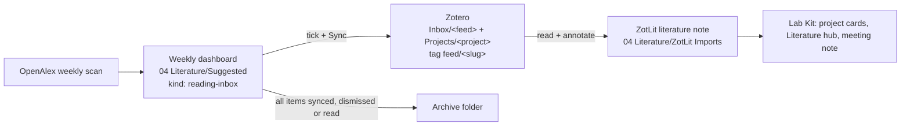

# Plan: literature-feed (companion plugin to Lab Kit)

_Agreed: 2026-10-12 (decisions in chat). Format follows Lab Kit's `docs/plans/_TEMPLATE.md`. Each phase = one session._

## Goal
New papers on my topics turn up each week in a reading-inbox dashboard in Obsidian; I tick the ones I want, press **Sync**, and they land in Zotero (inbox collection, project collection, feed tag), ready for my usual Zotero → ZotLit → Obsidian reading.

## Decisions taken
- **Separate plugin, id `literature-feed`**, linked to Lab Kit by note conventions only. Why: Lab Kit is store-listed with no network use; this plugin needs OpenAlex + Zotero calls (README disclosure, store review of its own). Rejected: a module inside Lab Kit (adds network + accounts to a published plugin); a Python script + Templater/Shell commands (Python on every machine, desktop only).
- **Native TypeScript, no other plugins needed.** Network through Obsidian's `requestUrl`; works on Windows, macOS and (probably) mobile.
- **Native button** (own code block + ribbon icon + command, no default hotkey). Rejected: Meta Bind button (extra dependency, static label).
- **Feeds in the settings tab**; each feed = name, search topics, concept groups with roles, exclusions, years from, Zotero collection, optional project.
- **One weekly dashboard note** with a collapsible section per feed, styled with Lab Kit's classes when present (`cssclasses: [vt]`, Lab Kit callouts, `vt-card` / `vt-badge`), plain Obsidian look otherwise.
- **Triage first:** only ticked papers go to Zotero (keeps the library clean).
- **Split jobs:** weekly scan (OpenAlex), sync whenever the button is pressed and once a day on start-up (Zotero only, no OpenAlex cost).
- **Inbox folder:** `04 Literature/Suggested` as the starting value (a setting; the repo default is empty, as in Lab Kit).
- **Notes kind:** `kind: reading-inbox`, so Lab Kit's literature lists and Tidy rules leave them alone.

## Out of scope
- LLM screening or summaries (no tokens; the scan is lexical, like the OpenAlex scan of 2026-10-04).
- Citation chasing, full text, PDFs (OpenAlex content download costs extra).
- Making literature notes: ZotLit's job, unchanged.
- Editing Lab Kit's kept files (`00 Home.md`, `Literature.md`): the Home card is one block I paste.

## How a paper moves

## Tiers (per feed)
| Tier | Rule |
|---|---|
| ⭐ Priority | every **required** group + a **priority** group |
| Strong | every **required** group + any **boost** group |
| Possible | every **required** group only |
| Dropped | a required group missing, or a **drop** term matched |

A paper with **no abstract** is matched on its title alone and can rank at most Possible (decided 2026-10-12; `docs/decisions.md`). The cap applies before lower terms. If the title does not show the required terms it is **Unchecked** and listed apart ("no abstract returned, matched by OpenAlex"), not Dropped; a drop term in the title still drops it, and lower terms do not apply to it. A feed with no required group never gives Unchecked.

A **lower** term (per feed) moves a paper down one tier (Priority → Strong → Possible → Dropped). Use **drop** for clearly off-topic meanings, **lower** for on-topic-but-less-wanted work.

## Phases

### Phase 0 — Repo scaffold
- Files: `manifest.json` (`literature-feed`, `isDesktopOnly: false`), `package.json`, `esbuild.config.mjs`, `tsconfig.json`, `eslint.config.mjs`, `vitest`, `src/main.ts` (empty plugin), `styles.css`, `README.md` (network + account disclosure: OpenAlex, Zotero; what is sent and why), `LICENSE` (MIT), `CLAUDE.md`, `STATUS.md`, `BACKLOG.md`, `.claude/` (rules, agents, skills copied from Lab Kit and trimmed), `.github/workflows/` (tests, release), `test-vault/`.
- Done when: `npm run build`, `npm test`, `npm run lint` pass; the plugin loads in `test-vault`.
- New dependencies: same dev tooling as Lab Kit.
- Repo: Claude Code creates the public GitHub repo `literature-feed` with `gh` and pushes the first commit, each only after asking me.

### Phase 1 — Matching engine (pure)
- Files: `src/match/feed.ts` (types), `src/match/score.ts` (normalise text, both spellings, phrase match, groups → tier, drop and lower terms), `src/match/dedupe.ts` (DOI, then normalised title; preprint + journal version → one, journal preferred), `tests/score.test.ts`, `tests/dedupe.test.ts`, `tests/fixtures/` (hand-written title + abstract cases).
- Done when: tests cover each tier, each drop term and each lower term for the lipoic acid feed below; no Obsidian imports in `src/match/`.
- **Done 2026-10-12** (`feat/matching-engine`, PR #1). Open points: BACKLOG → Decisions needed.

### Phase 2 — OpenAlex client
- Depends on: Phase 1
- Files: `src/openalex/client.ts` (injected `requestUrl`, `search.title_and_abstract`, `per_page=100`, `select=` fields, date window since the last scan via `from_publication_date`, 429 back-off, `meta.cost_usd` summed per run), `tests/openalex.test.ts` (responses hand-written to the documented shape until the real run), `scripts/openalex-run.mjs` (the real run).
- Done when: tests pass; **one real run with my key** reports the count and cost per topic (settles whether AND / OR / quoted phrases work as assumed).
- Changed after reading the OpenAlex docs (2026-10-12): the scoped parameter `search.title_and_abstract` replaces the filter form (deprecated per the docs; both are in `buildSearchUrl` until the real run); `from_publication_date` replaces created / updated dates (paid plan); key as Bearer header.
- **Code and tests done 2026-10-12** (`feat/openalex-client`). The real run is waiting on the key.

### Phase 3 — Settings tab
- Depends on: Phase 2
- Files: `src/settings/data.ts`, `src/settings/tab.ts`, `src/settings/feed-modal.ts`.
- Contents: global (OpenAlex key, Zotero key + user ID, inbox folder, archive folder, scan day); feed list (add, duplicate, delete, on / off, export / import as `.json`); per feed (topics, concept groups with role required / boost / priority, drop terms, lower terms, years from, Zotero collection, project); **Test** button = matches + estimated cost, nothing written.
- Done when: settings survive a reload and an external `data.json` change; sentence case, no inline styles (Lab Kit's plugin rules).
- Built 2026-10-12 (not yet seen in Obsidian): also `src/settings/test-feed.ts` and `src/openalex/request.ts`; the tab uses the declarative settings API; **Test** is a real one-year scan after a confirmation; export goes to the inbox folder; a feed with no required group gets a warning. See `docs/decisions.md`.

### Phase 4 — Weekly dashboard note
- Depends on: Phase 3
- Files: `src/inbox/write.ts` (pure: candidates → note text), `src/inbox/block.ts` (the `literature-feed` code block: status line, **Sync** button, counts), `styles.css`, tests.
- Note: `<inbox>/<YYYY-[W]WW> Reading inbox.md`, starts with an empty line (vault rule), `kind: reading-inbox`, `cssclasses: [vt]`; one collapsible callout per feed; each paper = checkbox, title, authors, venue, year, DOI link, tier badge, matched terms; quiet feeds collapsed. Built with `createEl` only (titles from OpenAlex are untrusted text).
- Same block with `show: home` = a small card for `00 Home` (papers waiting, last scan, Sync).
- Done when: tests on the note text; seen in `test-vault` in light and dark, with and without Lab Kit's CSS snippets.
- Built 2026-10-12 (not yet seen in Obsidian): also `src/inbox/scan.ts` and a **Scan now** command (so the note can be filled before Phase 7); own `.literature-feed-*` classes instead of Lab Kit's `vt` classes; the **Sync** button is shown disabled until Phase 5; Unchecked papers have their own callout per feed. See `docs/decisions.md`.

### Phase 5 — Zotero sync
- Depends on: Phase 4
- Files: `src/zotero/client.ts` (Web API v3: look up by DOI, create items, collections, tags), `src/inbox/sync.ts` (read ticks with `vault.process`, write back `zotero://select/…` link + "in Zotero" badge), tests with recorded responses.
- Each ticked paper: created once (DOI check against the library), added to `Inbox/<feed>` and, if the feed has a project, `Projects/<project>`; tag `feed/<slug>`.
- Done when: tests pass; **one real sync** of one paper into my library, seen in Zotero desktop after its sync.
- Built 2026-10-12 (not yet run against a real library): `src/zotero/client.ts`, `map.ts`, `request.ts`, `src/inbox/sync.ts`, the command **Sync ticked papers** and the block's **Sync** button; collections are created only if a setting allows it (inbox and project separately, off by default, last name only); an existing DOI gets the collections and tag added; test responses are hand-written until the real sync. See `docs/decisions.md`.

### Phase 6 — Read state and archive
- Depends on: Phase 5
- Files: `src/inbox/state.ts`, tests.
- A paper shows **Read** (link to its literature note) once a ZotLit note with the same DOI / Zotero key exists in the vault. A weekly note moves to the archive folder when every paper in it is synced, dismissed or read (unticked papers count as dismissed after N weeks, setting).
- Done when: tests; seen in `test-vault` with a hand-made literature note.
- Built 2026-10-13 (not yet seen in Obsidian): `src/inbox/state.ts`, `markRead` and `doi` / `read` in `src/inbox/write.ts`, `refreshInbox` and the command **Update read state and archive** in `src/main.ts`; settings for the literature folder, the archive switch and the dismiss weeks. The match ignores property names (key, DOI, then title). The archive rule is: every paper read or aged out. See `docs/decisions.md`.

### Phase 7 — Schedule, commands, ribbon
- Depends on: Phase 6
- Files: `src/main.ts`, `src/schedule.ts`.
- Scan on start-up when the scan day has passed since the last scan; sync on start-up once a day; commands **Scan now**, **Sync ticked papers**, **Open reading inbox**; ribbon icon; a Notice with the result ("12 new, 3 priority, cost $0.01").
- Done when: tests on the "is it due" rules; seen on Windows and Mac; phone checked (status bar not used).

### Phase 8 — Lab Kit side (in the Lab Kit repo, its own session, its own plan)
- Files: `src/kit/setup-check.ts` (`literature-feed` as an optional plugin), `kits/planning/07 How-tos/Obsidian/Vault spec.md` (kind `reading-inbox`, the `Suggested` folder), optional guide note with `needs: "plugin:literature-feed"`.
- Done when: Lab Kit tests and lint pass; no network code added to Lab Kit.

### Phase 9 — Release (my call)
- README final, release workflow, store submission with network + account disclosure.

## First feed (example, importable `.json` in `docs/feeds/`)
**Lipoic acid copolymers** — copolymerisation of lipoic / thioctic acid with acrylamides, acrylates and other monomers for responsive or degradable polymers.

- Topics:
  1. `("lipoic acid" OR "thioctic acid" OR lipoate) AND (copolymer OR copolymerization OR copolymerisation)`
  2. `("lipoic acid" OR "thioctic acid") AND (acrylate OR acrylamide OR methacrylate)`
  3. `("lipoic acid" OR "thioctic acid" OR dithiolane) AND ("radical ring-opening" OR "ring-opening polymerization" OR "ring-opening polymerisation")`
  4. `("lipoic acid" OR "thioctic acid") AND polymer AND (flow OR Bayesian OR "high-throughput" OR "machine learning")`
- Required: lipoic acid terms; polymerisation terms.
- Boost: comonomer class; responsive / degradable.
- Priority: flow / optimisation.
- Drop: gold nanoparticle, AuNP, quantum dot, self-assembled monolayer, supplementation, clinical trial, diabetic neuropathy.
- Lower one tier (decided 2026-10-12): self-healing, adhesive, ionic elastomer, end group, end-functional, anchoring group.
- Zotero: `Inbox/Lipoic acid copolymers`; project: `Projects/Lipoic acid copolymerisation`.

## Verification
- Phase 1: hand-checked fixture abstracts with a known tier each.
- Phase 2: real counts and cost from `meta.cost_usd` with my key, recorded in BACKLOG.
- Phase 5: one paper round-trip, checked in Zotero desktop.
- Every phase: say what was not seen in Obsidian (Lab Kit's rule).

## Decided 2026-10-12
1. Project for the first feed: `Projects/Lipoic acid copolymerisation`.
2. Finished weekly inbox notes move to the archive automatically (setting, on by default); papers get their notes from ZotLit in `ZotLit Imports` as now. Unticked papers count as dismissed after 4 weeks (setting).
3. Off-topic terms come in two kinds: **drop** and **lower one tier**.

## Open questions
- None. New ones go to `BACKLOG.md`.
